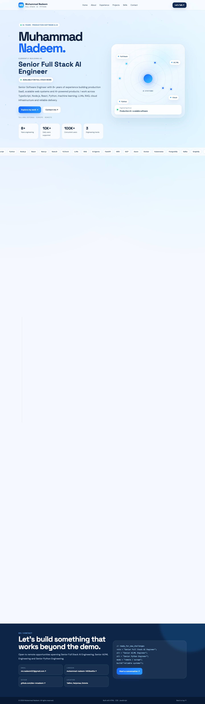

# Personal portfolio page

A static personal portfolio kept as a single `index.html` file. Its HTML, styles
and browser scripts live together, so there is no package manager or build step.

```bash
python3 -m http.server 8080 --bind 127.0.0.1
```

Open http://127.0.0.1:8080. Edit `index.html` and refresh the browser to preview a
change. External links and any third-party assets require a network connection;
serving the page itself does not need an API key or database.

This is the source page rather than a publishing service. Updating GitHub does
not establish that a separate hosted deployment has been updated.

## Source preview



[Mobile preview](docs/screenshots/native-mobile.png). These are captures of this
repository served locally, with browser rendering and JavaScript error checks
recorded in [native-browser.json](docs/native-browser.json). They do not certify
the state of any separate hosted deployment.
